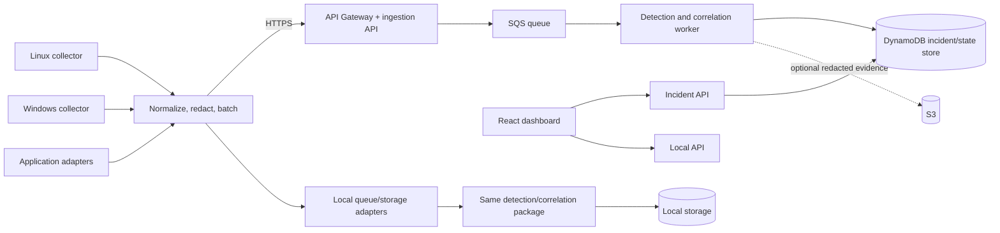

# 🏗️ Architecture & System Design Guide — Automated Log Anomaly Detector

> **Document status:** Developer implementation guide, derived from `docs/MAIN_ARCHITECTURE.md` (planning specification). Nothing in this guide implies that code exists, tests have passed, or AWS resources have been deployed. Every command, snippet, and number here is a **proposal to be verified** during implementation.

**Audience:** Backend, detection/ML, and DevOps engineers implementing the MVP.
**Read together with:**
- `02_DETECTION_AND_AI_GUIDE.md` — detection, correlation, incident building
- `03_CLOUD_AND_BACKEND_GUIDE.md` — AWS/SAM specifics
- `04_DEVOPS_COLLECTORS_AND_FRONTEND_GUIDE.md` — collectors, local mode, CI, dashboard
- `05_API_AND_DATA_CONTRACTS_GUIDE.md` — the canonical event/incident/API contracts

---

## 1. High-Level Overview & Goals

### 1.1 The problem we are solving

DevOps engineers monitor high-volume, fast-growing log streams. Two failure modes dominate:

1. **Fixed rules miss the unexpected.** A rule like `5xx_count > 100` only catches what someone already imagined. It cannot express "this host's error rate is unusual *for this host at this hour*."
2. **Raw alert streams lack context.** A database timeout and an HTTP 500 spike that share a request trace are one incident. Two unrelated outages in the same minute are two incidents. Timestamp proximity alone cannot tell them apart — but evidence can.

The product answer is a pipeline that **collects → normalizes → detects → correlates → explains**, and presents the result as an *incident with evidence*, not as an unexplained red number.

### 1.2 Goals (MVP)

| # | Goal | Verification |
|---|------|--------------|
| G1 | Collect supported telemetry from **Linux**, **Windows**, and **application** sources | Contract-valid fixtures from each collector |
| G2 | Normalize events through a **versioned shared contract** | Schema validation + contract tests |
| G3 | Detect deviations with **transparent statistical baselines** | Reproducible evaluation, formula documented |
| G4 | Evaluate **Isolation Forest** as a complementary detector | Held-out comparison vs. baseline |
| G5 | Correlate events into **incidents** using evidence and relationships | Synthetic ground truth, false-merge/missed-link counts |
| G6 | Show incidents, timelines, hypotheses, and diagnostic checks in a **React dashboard** | Fixture incidents rendered through the real API |
| G7 | Run **locally with no AWS credentials** and deploy to **AWS via SAM** | Two end-to-end vertical slices |
| G8 | Demonstrate **reliability, privacy, and measurable evaluation** | Test layers 1–8 in the testing plan |

### 1.3 Non-goals (equally important)

The following are **explicitly out of scope**. When a design discussion drifts toward them, record the idea in the decision log and return to scope:

- ❌ **No automated remediation.** No service restarts, no firewall changes, no "auto-heal" actions of any kind.
- ❌ **No universal protocol coverage.** We support defined sources, not arbitrary traffic.
- ❌ **No full raw-log archive by default.** Redacted evidence only, and only when justified.
- ❌ **No mandatory LLM.** Detection must be transparent and evaluable without any model. An external model is deferred and must never receive sensitive raw logs by default.
- ❌ **No claimed root cause from timing alone.** Timing is supporting evidence, not proof of causation.

### 1.4 Primary user & identity model

There is exactly **one administrator** monitoring their own authorized machines and services. That single fact shapes the whole security model:

- **Administrator identity** — reads incidents, acknowledges/resolves them. Full dashboard access.
- **Collector identity (per host or per fleet)** — may **only** submit event batches. Collectors can *never* list or read incidents.

These are separate credentials with separate IAM policies. Hiding a button in the UI is not authorization; every check is enforced server-side (see §7 and the security guide).

### 1.5 Deployment modes: one codebase, two runtimes

A recurring architectural rule in this project:

> **The detection and correlation package, the event contract, and the incident contract are identical in local mode and AWS mode. Only the adapters change.**

```
                 ┌──────────────────────────────────────────┐
                 │   Shared core (pure Python, no cloud)    │
                 │  contracts · features · detection ·      │
                 │  correlation · incident building         │
                 └──────────────────────────────────────────┘
                        ▲                          ▲
        local adapters ─┘                          └─ AWS adapters
   (in-proc queue, SQLite/Disk)                (SQS, DynamoDB, Lambda)
```

If this boundary is violated — e.g., detection code imports `boto3` directly — local mode stops being credential-free and the "works without AWS" acceptance gate fails. Enforce it with an import-linter contract or an architecture test (§6.4).

---

## 2. System / Component Architecture & Design Patterns

### 2.1 End-to-end architecture



**Read the diagram as two horizontal lanes that share the middle block:**

- **Top lane (AWS):** collector → API Gateway → ingestion Lambda → SQS → worker Lambda → DynamoDB (+ optional S3), with the dashboard talking to the incident API.
- **Bottom lane (local):** collector → local queue adapter → *the same worker package* → local storage adapter, with the dashboard talking to a local API.

### 2.2 Component inventory

| Component | Responsibility | Must NOT do |
|---|---|---|
| **Collectors** (Linux/Windows/app) | Read native sources, normalize envelope, redact, batch, retry | Detect anomalies; read incidents; hold long-term state |
| **Ingestion API** | Authenticate, validate, enforce limits, dedupe on ingest, enqueue, return receipt | Run detection synchronously; promise "analyzed" |
| **Queue (SQS / local)** | Buffer, retry, decouple ingest from processing | Be treated as a database |
| **Detection worker** | Features → statistical baseline → (experiment) Isolation Forest → correlate → incidents | Block on network beyond storage; trust its own RAM as persistence |
| **Persistence** (DynamoDB / local store) | Incidents, idempotency records, baseline/window state, audit | Store full raw logs by default |
| **Incident API** | Read incidents, lifecycle actions, authz enforcement | Accept event submission from admins-only paths |
| **React dashboard** | Render incidents, timelines, evidence, hypotheses, checks | Hold secrets; decide authorization |

### 2.3 The nine-step processing pipeline

The worker is a **linear, side-effect-bounded pipeline**. Each step is a pure-ish function over a value object, with the only impure steps being persistence and clock access (both injected, so tests can control them).

```
 1. Validate event and timestamp
 2. Deduplicate by stable event ID
 3. Normalize supported fields; extract patterns/templates where feasible
 4. Aggregate into time windows per host/service/source and dependency
 5. Compute features
 6. Run statistical baseline detector
 7. Run Isolation Forest as an experiment on selected numeric features
 8. Correlate anomalies and evidence
 9. Create/update incidents; attach deterministic explanation,
    uncertainty, and diagnostic checks
```

**Design patterns applied:**

- **Pipeline / Step pattern** — each numbered step has a single input/output type; failures at step 1–2 are *rejections*, failures at 6–9 are *recorded uncertainties*, never crashes.
- **Ports & Adapters (Hexagonal)** — the pipeline depends on `QueuePort`, `StorePort`, `ClockPort`, `FeatureRepositoryPort`; AWS and local provide implementations.
- **Idempotency by stable ID** — steps 2 and 9 are written so that replaying a message twice yields the same stored state (SQS is *at-least-once*).
- **Graceful degradation** — if the ML experiment (step 7) fails, the incident from step 6 still ships; the incident records which detectors actually ran.
- **Explain-everything output** — step 9 never emits a bare boolean. Every incident carries observed vs. baseline values, window, entity, detector, evidence IDs, alternatives, and missing evidence.

### 2.4 Data flow (numbered, with contracts)

1. Collect supported events through **native OS/application mechanisms** (journald, Windows Event Log, application log files).
2. Normalize into a **shared event envelope**; preserve useful source-specific attributes under `attributes` rather than flattening them away.
3. **Redact** sensitive data, apply size limits, assign **stable event IDs**, buffer, and batch (≤100 events or ≤256 KB, whichever first).
4. **Authenticate and validate** ingestion requests (schema, version, timestamps, payload limits).
5. **Queue** accepted events and return a documented receipt with explicit accepted/rejected counts.
6. Process **idempotently**: compute windowed features, run statistical detection and the ML experiment, then correlate evidence.
7. **Create/update incidents** and persist compact state.
8. **Display** incident details and diagnostic recommendations in the dashboard.

⚠️ **Critical semantic:** API acceptance into the queue ≠ detection completed. The receipt says "accepted for processing," and the UI must never imply an incident exists at submit time.

### 2.5 Design patterns catalog (and where they apply)

| Pattern | Where | Why |
|---|---|---|
| **Ports & Adapters** | queue, store, clock, config | Local/AWS parity; testability |
| **Envelope/Schema Versioning** | event contract (`schema_version`) | Evolution without breaking collectors mid-fleet |
| **Idempotent Consumer** | worker steps 2, 9 | At-least-once delivery |
| **Dead-Letter Queue** | SQS DLQ / local dead-letter file | Poison messages must not loop forever |
| **Circuit guard / bounded buffer** | collector buffer, Lambda batching | Backpressure instead of OOM |
| **Outbox-less eventual consistency** | queue between API and worker | Decouple availability: API up, worker down → no data loss |
| **Repository** | incident/baseline persistence | Swap DynamoDB ↔ local store |
| **Strategy** | detectors (statistical, isolation forest) | Compare detectors behind one interface |
| **Explainable result object** | incident hypotheses | Deterministic templates, no free-form generation |
| **Anti-corruption layer** | normalization step | OS-specific fields never leak into core logic |

### 2.6 State ownership — what lives where

| State | Owner | Durable? | Notes |
|---|---|---|---|
| Raw event batch | Collector → queue | Queue lifetime only | Bounded; dropped with logged metrics when buffer fills |
| Processed event IDs (dedup) | Store | Yes (TTL) | Prevents duplicate incidents on replay |
| Rolling baseline per feature | Store | **Yes — mandatory** | "Never rely on Lambda process memory for persistence." Lambda containers are evicted silently; a baseline kept in RAM would reset per invocation and produce inconsistent scores. |
| Window aggregates | Store (compact) | As long as needed | Justify each retained aggregate |
| Incident + hypotheses + audit | Store | 30 days (configurable default) | TTL deletion is asynchronous — see §7.4 |
| Redacted evidence refs | Store / optional S3 | 7 days | Not full raw logs |
| UI session/filter state | Browser | No | URL-query driven so links are shareable |

### 2.7 Repository structure (proposed)

Monorepo. Contracts are canonical and shared by all tracks:

```
log-anomaly-detector/
├── contracts/
│   ├── schemas/
│   │   ├── event.schema.json
│   │   ├── incident.schema.json
│   │   └── api-errors.schema.json
│   ├── openapi.yaml
│   └── fixtures/                    # valid + invalid examples, used by ALL tracks
├── src/
│   └── lad/                         # shared Python package
│       ├── contracts/               # pydantic/dataclass models + schema loaders
│       ├── normalize/               # envelope mapping, template extraction, redaction
│       ├── features/                # windowing + feature computation
│       ├── detection/
│       │   ├── statistical/         # baseline, thresholds, contamination guard
│       │   └── isolation_forest/    # experiment, versioned artifacts
│       ├── correlate/               # evidence graph, windows, quiet periods
│       ├── incidents/               # lifecycle, hypotheses, explanations
│       ├── ports/                   # QueuePort, StorePort, ClockPort protocols
│       └── adapters/
│           ├── aws/                 # SQS, DynamoDB, Lambda entrypoints
│           └── local/               # in-proc queue, SQLite/filesystem store
├── services/
│   ├── api/                         # FastAPI app (ingestion + incident API)
│   └── worker/                      # batch handler wiring the pipeline
├── collectors/
│   ├── linux/
│   ├── windows/
│   └── app_adapters/
├── dashboard/                       # React + TypeScript
├── evaluation/                      # scenarios, generators, metrics, reports
├── infra/                           # SAM template, params, policies
├── scripts/                         # make targets, seed/reset, demo helpers
├── tests/
│   ├── unit/  contract/  integration/  reliability/  security/  e2e/
├── docs/
│   ├── planning/                    # this planning pack (baseline specs)
│   └── decisions/                   # decision log (ADR-style)
├── Makefile
├── pyproject.toml
├── .env.example
└── docker-compose.yml               # local mode dependencies
```

**Rule:** `src/lad/` must never import from `services/`, `collectors/`, `infra/`, or `boto3`. Collectors may import `lad.contracts` and `lad.normalize` only. This is what keeps the "same detection package in both modes" promise honest.

---

## 3. Environment Setup & Prerequisites

> ⚠️ Exact versions must be **verified during setup**, not copied blindly. The stack below is proposed; pin what you actually test.

### 3.1 Prerequisites checklist

- [ ] **Python** — a currently supported 3.x release; confirm FastAPI/pytest/pydantic/scikit-learn compatibility before pinning.
- [ ] **Node.js + npm/pnpm** — for the React dashboard; confirm Vite/React/TypeScript compatibility.
- [ ] **Docker + Docker Compose** — local dependencies (and optionally local services).
- [ ] **AWS CLI + SAM CLI** — only for the AWS lane; **not required** for local mode.
- [ ] **An AWS account** with permission to create Lambda, API Gateway, SQS, DynamoDB, IAM, CloudFormation resources — verify quotas and pricing first.
- [ ] **A Linux machine** (journald access) and **a Windows 11 machine** (Event Log access) for collector work.
- [ ] `make` (or an equivalent task runner).

### 3.2 First-time setup (local lane only)

```bash
# 1. Clone and enter the repo
git clone <repo-url> && cd log-anomaly-detector

# 2. Python environment
python -m venv .venv && source .venv/bin/activate
pip install -e ".[dev]"

# 3. Frontend dependencies
(cd dashboard && npm install)

# 4. Copy non-secret configuration — never commit real values
cp .env.example .env

# 5. Start local dependencies (if you use Compose for storage/queue emulation)
docker compose up -d

# 6. Run the full local check suite
make lint test contract

# 7. Start the local lane end-to-end
make local-up          # API + worker + storage adapters
make seed-normal       # synthetic normal traffic, fixed seed
make dashboard         # dev server on the configured port
```

**Gate check:** none of the above steps may require `aws configure`. If any script demands credentials, it belongs to the AWS lane and must be isolated (see `04_DEVOPS_...` §5).

### 3.3 `.env.example` (non-secret examples only)

```bash
# --- local lane ---
LAD_MODE=local
LAD_API_BASE_URL=http://localhost:8080
LAD_STORAGE_BACKEND=local          # local | dynamodb
LAD_QUEUE_BACKEND=local            # local | sqs
LAD_LOG_LEVEL=INFO
LAD_CORRELATION_WINDOW_SECONDS=120
LAD_QUIET_PERIOD_SECONDS=600
LAD_MAX_BATCH_EVENTS=100
LAD_MAX_BATCH_BYTES=262144

# --- collectors (submission-only credential placeholder) ---
LAD_COLLECTOR_ENDPOINT=http://localhost:8080/api/v1/events/batch
LAD_COLLECTOR_ID=host-alpha
# LAD_COLLECTOR_TOKEN=...          # injected at runtime; never committed

# --- AWS lane (filled only when deploying) ---
# LAD_MODE=aws
# AWS_REGION=us-east-1
```

### 3.4 Makefile targets (proposed contract for tooling)

```makefile
setup:            ## install python + node deps, copy env
lint:             ## formatters + linters (python and frontend)
test:             ## unit tests
contract:         ## validate fixtures against JSON Schema + OpenAPI
integration:      ## API → queue → worker → store, local adapters
security:         ## authz boundaries, redaction, secret scan
local-up:         ## start local API, worker, storage
seed-normal:      ## generate normal synthetic traffic (fixed seed)
seed-anomaly:     ## generate a labeled anomaly scenario (fixed seed)
demo-reset:       ## clear demo data (documented, reversible)
dashboard:        ## start React dev server
sam-validate:     ## sam validate + build (AWS lane only)
deploy:           ## parameterized deploy (AWS lane only)
teardown:         ## documented cleanup (AWS lane only)
```

Every target must be safe to run twice and must print what it is about to do.

---

## 4. Step-by-Step Implementation Guide

> This guide sequences the build so that each step ends in a **runnable, testable artifact**. It deliberately front-loads contracts and local mode; AWS comes only after a working local vertical slice (mirroring Gates 0–3).

### Step 0 — Gate 0: repository, contracts, decision log

1. Create the monorepo layout in §2.7.
2. Author `contracts/schemas/event.schema.json` and `incident.schema.json` **before** any producer/consumer code.
3. Author `contracts/openapi.yaml` for the six endpoints.
4. Add 5+ valid fixtures and 10+ invalid fixtures (see `05_API_...`).
5. Write the decision log template:

```markdown
# ADR-0001: Use stable event IDs assigned at the collector
- Status: Accepted
- Context: SQS delivers at-least-once; retries must not create duplicate incidents.
- Decision: ID = UUIDv7 (time-ordered) generated once, persisted in the local buffer, reused on retry.
- Consequences: + deterministic dedup, + sortable IDs; − collector must persist pending IDs across restarts.
- Verified by: tests/reliability/test_duplicate_delivery.py
```

**Exit criteria:** `make contract` passes on all fixtures; docs reviewed as a team.

### Step 1 — Contract layer in Python

Build `lad/contracts` so every later module consumes typed objects, not raw dicts.

```python
# src/lad/contracts/event.py  (illustrative — verify against the JSON Schema)
from __future__ import annotations
from dataclasses import dataclass, field
from datetime import datetime
from typing import Any, Mapping

SUPPORTED_SCHEMA_VERSIONS = ("1.0",)

@dataclass(frozen=True, slots=True)
class Event:
    schema_version: str
    event_id: str            # stable across retries
    event_ts: datetime       # source time, timezone-aware
    observed_ts: datetime    # when we saw it, timezone-aware
    host: str
    source: str              # e.g. "journald", "windows-eventlog", "app-nginx"
    service: str | None
    category: str            # e.g. "http", "auth", "db", "process"
    type: str                # e.g. "http_5xx", "auth_failure"
    severity: str            # info | warning | error | critical
    message: str
    template: str | None     # extracted pattern, if feasible
    attributes: Mapping[str, Any] = field(default_factory=dict)   # numeric or structured
    trace_id: str | None = None
    request_id: str | None = None
    depends_on: tuple[str, ...] = ()
    evidence_ref: str | None = None   # optional redacted evidence pointer
```

**Rules encoded here:**
- Timestamps are **timezone-aware**; normalize to UTC at the contract boundary.
- **Missing is not zero** — optional numerics are `None`, and downstream code must skip, not default.
- Unknown optional fields follow the documented compatibility policy (accept/ignore/preserve — decide in ADR and test it).

**Tests:** round-trip every fixture through `Event`; assert invalid fixtures fail with actionable paths.

### Step 2 — Normalization + redaction

```python
# src/lad/normalize/pipeline.py (illustrative)
def normalize(raw: RawRecord, *, source: SourceAdapter, clock: ClockPort) -> Result[Event, Reject]:
    if not source.supports(raw):
        return Reject("unsupported_record", detail=source.describe())
    ts = source.extract_timestamp(raw)
    if ts is None or not ts.tzinfo:
        return Reject("invalid_timestamp")           # never silently use "now"
    event = source.to_envelope(raw, ts)
    event = redact(event)                            # tokens, passwords, session IDs
    if not within_limits(event):
        return Reject("payload_too_large")           # documented limit
    return Ok(event)
```

**Design notes:**
- **Redaction happens before buffering and again before any remote transmission.** Defense in depth: a bug in one call site does not leak.
- Template extraction (e.g., splitting `user=alice failed` from `user=bob failed` into a shared template) is *best effort*; when it fails, `template` stays `None` and the feature layer treats the feature as absent.
- Rejections are **counted and logged as metrics** (rejected_total{reason}) so silent data loss is impossible.

### Step 3 — Ports and local adapters

Define protocols first; implement the local lane second.

```python
# src/lad/ports/queue.py
from typing import Protocol, Sequence

class QueuePort(Protocol):
    def send(self, messages: Sequence[bytes]) -> None: ...
    def receive(self, max_messages: int, visibility_timeout_s: int) -> Sequence[Handle]: ...
    def ack(self, handle: Handle) -> None: ...
    def nack(self, handle: Handle, *, retryable: bool) -> None: ...
```

Local implementations:
- **Queue:** in-process or a directory-backed queue (one JSON file per message + `dead/` folder) — simple, inspectable, no broker to run.
- **Store:** SQLite with WAL, or JSON documents on disk for the demo scale. Must implement TTL semantics explicitly, because "TTL deletion is asynchronous" in DynamoDB has local analogues (you must not pretend rows vanish instantly).

**Exit criteria:** `make integration` runs API → local queue → worker → local store with fixtures and asserts incident rows appear.

### Step 4 — Features + windows (see `02_...` for formulas)

- Aggregate by `(host, service, source, window_start, feature)`.
- Window sizes: start with **60s tumbling windows** for rates and **5m tumbling windows** for latency percentiles; make both configurable.
- Only compute a feature when the relevant source provides it. `http_5xx_ratio = None` when there are no HTTP events — **never 0.0**.

```python
@dataclass(frozen=True)
class FeatureVector:
    window_start: datetime
    window_s: int
    entity: EntityKey                 # host/service/source/dependency
    values: Mapping[str, float | None]  # None = not provided by source
    sample_counts: Mapping[str, int]    # for minimum-sample gating
    cold_start: bool
```

**Exit criteria:** unit tests assert `None` propagation and minimum-sample gating; a snapshot test documents exactly which features each fixture source produces.

### Step 5 — Statistical baseline detector

Implement, document, and test (details in `02_...`):

1. Rolling or time-of-day baseline with **minimum sample thresholds**.
2. **Robust summaries** (median / MAD) because outliers are common.
3. Explicit **cold-start** status: no alerting until enough samples exist; the incident/UI shows "warming up."
4. Configurable thresholds and/or a robust z-score.
5. **Contamination guard:** during an active anomaly, pause or gate baseline updates (or use robust limiting) so an attack is not learned as normal.
6. Durable baseline state via `StorePort` — never Lambda memory.

```python
# Sketch of the guard — see guide 02 for the full design
def update_baseline(state: BaselineState, value: float, *, anomaly_active: bool) -> BaselineState:
    if state.cold_start:
        return state.seeded_with(value)
    if anomaly_active:
        return state.with_update_paused()   # record "paused" for auditability
    return state.robust_update(value)       # median/MAD, bounded drift
```

**Exit criteria:** unit tests prove (a) no alerts during cold start, (b) baseline does not move during an injected anomaly, (c) state survives a simulated process restart.

### Step 6 — Isolation Forest experiment (optional, behind a flag)

- Train **only** on the training split; no leakage across adjacent windows from the same incident.
- Record: parameters, random seed, feature list, data version, model artifact/version.
- Threshold scores using training/validation data; **never tune on the test set**.
- Ship behind `LAD_DETECTOR_ISOLATION_FOREST=off|shadow|on`.
  - **shadow:** compute and log the score, but do not let it create incidents — ideal for comparison without user-visible risk.
- If it doesn't improve useful metrics or costs too much integration time: document the experiment, keep the statistical detector as the MVP detector, and say so honestly in the demo.

**Exit criteria:** a reproducible report comparing both detectors on identical held-out scenarios, including false alerts/hour and detection delay.

### Step 7 — Correlation + incident building

Correlate using **relationship evidence**, not just time:

- common host/service identity
- explicit request/trace IDs when available
- known dependency metadata
- compatible event categories
- event ordering and time windows
- repeated evidence and incident lifecycle state

Defaults: **correlation window = 2 minutes**, **quiet period = 10 minutes** (configurable). Quiet period elapsing is *not* proof of recovery.

```python
# incident fields kept deliberately separate
anomaly_score: float        # detector-specific unusualness
severity: str               # estimated operational impact (documented rules)
hypo_confidence: str        # strength of support for an explanation — NOT a probability
```

Each hypothesis stores `supporting_event_ids`, `contradicting_event_ids`, and `missing_evidence`. **"Unknown" is a valid outcome.** Diagnostic recommendations are specific, evidence-linked, and **non-executing**.

**Exit criteria:** synthetic scenarios 1–5 pass: unrelated simultaneous anomalies stay separate; DB timeout + HTTP 500 spike correlate with evidence.

### Step 8 — API surface (six endpoints)

Implement exactly what `openapi.yaml` documents:

| Method | Path | Actor |
|---|---|---|
| POST | `/api/v1/events/batch` | collector |
| GET | `/api/v1/health` | anyone (no secret leakage) |
| GET | `/api/v1/incidents` | admin (paginated, filterable) |
| GET | `/api/v1/incidents/{incident_id}` | admin |
| POST | `/api/v1/incidents/{incident_id}/acknowledge` | admin |
| POST | `/api/v1/incidents/{incident_id}/resolve` | admin |

Anything not in the spec is **undocumented behavior** — write the spec first, then the code.

**Exit criteria:** contract tests assert 401/403 boundaries: collector token → 403 on any `/incidents` path; no token → 401 on ingestion.

### Step 9 — Local vertical slice (Gate 2)

The single most important demo proof:

```
seed-anomaly (fixed seed)
   → real local collector/adapter
   → POST /api/v1/events/batch (real HTTP)
   → local queue
   → worker pipeline (steps 1–9)
   → local store
   → GET /api/v1/incidents
   → dashboard renders timeline, baseline vs observed, evidence, checks
```

⚠️ **Never seed an incident directly into storage for the primary demo.** If the incident doesn't arrive through the real path, the demo proves nothing.

### Step 10 — AWS vertical slice (Gate 3)

Only after Step 9 is green:

```bash
sam validate
sam build
sam deploy --guided --parameter-overrides Env=dev
# verify, don't assume:
curl -fsS "$API_URL/api/v1/health"
# then one real end-to-end anomaly through the deployed path
```

See `03_CLOUD_AND_BACKEND_GUIDE.md` for template structure, IAM, DLQ, and cost controls. **Never state that deployment succeeded until commands/results verify it.**

### Step 11 — Hardening (Gate 4) and freeze (Gate 5)

- Reliability: retries, duplicate delivery, delayed/out-of-order events, worker restart, DLQ, buffer overflow.
- Security: authz, redaction, safe rendering, secret scanning, size limits.
- Detector comparison with reproducible metrics.
- Feature freeze → docs → deployment rehearsal → demo. (Baseline plan: working path by ~Oct 24, Oct 29–31 reserved for hardening/rehearsal — reconfirm dates with the team.)

---

## 5. Data Models & State Management

### 5.1 Event envelope (summary — canonical definition in `contracts/schemas/event.schema.json`)

Required-ish core: `schema_version`, `event_id`, `event_ts`, `observed_ts`, `host`, `source`, `category`, `type`, `severity`, `message`.
Optional: `service`, `template`, numeric `attributes`, `trace_id`/`request_id`, `depends_on`, `evidence_ref`.

**Invariants:**
1. Timezone-aware timestamps, normalized to UTC at the boundary.
2. Missing ≠ 0 (or `""`, or `false`).
3. Stable IDs survive retries.
4. Source-specific fields stay optional and structured under `attributes`.
5. Never require every source to provide HTTP or database fields.
6. Raw evidence is optional and redacted.
7. Field/payload limits enforced at ingestion.

### 5.2 Incident model

| Group | Fields |
|---|---|
| Identity | `incident_id`, `schema_version`, `created_at`, `updated_at` |
| Lifecycle | `status`: `open → acknowledged → resolved` (+ reopen path) |
| Impact | `severity` (documented rules), `affected_entities` |
| Detection | `anomaly_score`, `detector`(s) run, `model_versions`, window(s) |
| Evidence | `event_ids` (supporting + contradicting), optional redacted refs |
| Reasoning | `hypotheses[]` with `statement`, `supporting`, `contradicting`, `missing`, `confidence` |
| Actions | `diagnostic_checks[]` — specific, evidence-linked, **non-executing** |
| Audit | `acknowledged_by/at`, `resolved_by/at`, actor identity |

**Three separate concepts that must never be collapsed:**

```
anomaly_score     → how unusual (detector-specific, not a probability)
severity          → operational impact estimate (rule-based)
hypo_confidence   → strength of support for an explanation
```

Calling an anomaly score "a probability" in UI or demo narration is a factual error — treat it as a bug.

### 5.3 State machines

**Incident lifecycle:**

```
            acknowledge
   open ──────────────────► acknowledged
    ▲                            │
    │ reopen (new evidence       │ resolve
    │ within quiet window)       ▼
    └──────────────────────── resolved
```

- Resolve without acknowledge: allowed? **Decide in an ADR and test it.** (Recommendation: allow, since single-admin operation makes forced sequences annoying.)
- Reopen: only with new supporting evidence, and must append an audit entry rather than mutating history.

**Collector buffer:**

```
fill → (≤100 events | ≤256 KB | flush interval) → send → backoff+jitter on failure
     → buffer full → bounded behavior: drop-oldest or block, chosen deliberately,
        with dropped_total metric logged
```

**Baseline state:** `cold_start → seeded → active (updating) ⇄ paused (anomaly active)` — persisted, auditable, never silent.

### 5.4 Persistence design rules

1. **Design around access patterns before selecting keys** (DynamoDB specifics in `03_...`):
   - list incidents by time/status/severity
   - fetch incident by ID
   - track processed event IDs (idempotency)
   - store compact baseline/window state when justified
2. Store **only compact state** — window aggregates, baselines, incident records. Not raw logs.
3. **Retention defaults (configurable test defaults, not guarantees):**
   - incidents: **30 days**
   - selected redacted evidence + detailed debug logs: **7 days**
   - baseline/window state: only as long as needed
4. TTL deletion is **asynchronous** — if strict cleanup is required, implement a policy that accounts for this and test it.
5. Every write path is idempotent: `PutIncident` keyed so that a replayed message overwrites with an equivalent or newer version, never appends a duplicate.

### 5.5 Data volume & load model (initial defaults)

| Parameter | Default | Type |
|---|---|---|
| Sustained test | 5 events/sec for 10 min | test target |
| Burst test | 25 events/sec for 60 s | test target |
| Batch limit | 100 events or 256 KB | whichever first |
| Correlation window | 120 s | configurable |
| Quiet period | 600 s | configurable |
| Incident retention | 30 d | configurable |
| Evidence/debug retention | 7 d | configurable |

⚠️ These are **starting targets to test, not performance guarantees.** If real quotas prevent a test, record the limitation rather than fabricating a result.

---

## 6. Security, Testing, and Deployment Considerations

### 6.1 Security architecture (summary; full detail in `SECURITY_AND_PRIVACY.md`)

**Trust boundaries** (each one is a place to write an explicit test):

```
monitored host → collector → ingestion API → queue → worker → storage
dashboard → API → administrator
build/deployment environment → AWS
```

**Core controls baked into this architecture:**

- 🔐 Separate **collector** and **administrator** identities; collectors cannot read incidents (server-side).
- 🔐 **HTTPS** for all remote ingestion; no AWS keys in collectors or frontend bundles.
- 🔐 **Schema validation + payload limits** before anything is enqueued.
- 🔐 **Stable IDs + idempotent processing** neutralize replay/duplication attacks.
- 🔐 **Redaction** of tokens, passwords, session IDs before transmission *and* before storage.
- 🔐 **Treat logs as untrusted data, never as instructions** — no log-derived string is ever executed, interpolated into a shell, or rendered as HTML.
- 🔐 **No secrets in Git, frontend bundles, command output, or logs.**
- 🔐 **Least-privilege IAM**, no wildcard permissions where practical.
- 🔐 **Audit** acknowledge/resolve actions.
- 🔐 **Baseline contamination tests** — a system must not rapidly learn an attack as normal.
- 🚫 No automatic remediation, no unauthorized scanning.

**Threats this architecture specifically answers:**

| Threat | Architectural answer |
|---|---|
| Compromised collector credentials | Collector can only POST events; blast radius = junk events, which dedup/validation limit |
| Unauthorized incident access | Admin-only routes + server-side authz tests |
| Malicious log strings | Escaping at render; logs never treated as instructions |
| Poisoned baselines | Contamination guard + update pause + audit |
| Oversized payloads | Limits at collector *and* API |
| Duplicate/replayed events | Stable IDs + idempotent worker |
| Unexpected cloud spend | No always-on compute; budget/usage alerts; teardown documented |

### 6.2 Testing strategy (mapped to architecture)

| Layer | What it proves here | Key examples |
|---|---|---|
| 1. Unit | Pure pipeline steps | parsers, normalization, redaction, features, detector, lifecycle |
| 2. Contract | Contracts are enforceable | JSON Schema/OpenAPI validation, version compat, valid/invalid fixtures |
| 3. Integration | Components actually connect | API → queue → worker → store → dashboard API |
| 4. Reliability | Failure is survivable | retries, duplicates, delayed events, worker restart, DLQ, buffer overflow |
| 5. Security | Boundaries hold | authz, redaction, safe rendering, secret scan, size limits |
| 6. Platform | Collectors work on real OSes | Linux journald, Windows Event Log (Win 11) |
| 7. E2E | The product works | local path and AWS path scenarios |
| 8. Detector eval | Detection is measurable | reproducible normal/anomalous scenarios, false alerts/hour, delay |

**Pass/fail gates (extracted):**

- [ ] A synthetic anomaly traverses the **actual local pipeline** and appears in the dashboard.
- [ ] Related DB and HTTP events correlate with supporting evidence.
- [ ] Unrelated simultaneous anomalies remain **separate**.
- [ ] Duplicate submissions do not create duplicate incidents.
- [ ] Linux and Windows collectors emit contract-valid events.
- [ ] Collector credentials **cannot** read incidents.
- [ ] Local mode works **without AWS credentials**.
- [ ] AWS path works when credentials/permissions are available.
- [ ] Detector comparison is reproducible and reports false positives and missed anomalies.

**Reporting rule:** every result records software version/commit, dataset/scenario, random seed, split, parameters, event counts, metric definition, measured result, and limitations. **Never claim tests passed unless they were run.**

### 6.3 Deployment considerations

**Local lane**
- One command (or small sequence) starts services, seeds data, opens the dashboard, resets data, and inspects logs.
- Clean reset command for demo data, documented and reversible.
- No AWS credentials anywhere in this path (verify with a negative test: unset all `AWS_*` and rerun).

**AWS lane (overview; full detail in `03_...`)**
- SAM-managed: API, queue/DLQ, workers, persistence, roles, logs, optional static frontend hosting.
- Parameterized environments; development and demo environments separated where feasible.
- Secrets outside source control; resource policies attached; timeouts/memory/batch sizes configured coherently (visibility timeout ≥ worker timeout × retries).
- Outputs, rollback, and recovery instructions documented.
- **Verify before claiming success:** `sam validate`, deployed health check, one real end-to-end scenario, dashboard/API connectivity, permission review, cost review.

**Cost posture**
- Avoid always-on EC2, Kinesis, and managed search unless justified.
- Use a measured workload and inspect *actual* usage; free-tier rules vary and don't guarantee zero cost.
- Budget/usage alerts where available — they do **not** necessarily stop spending.
- Document cleanup and identify persistent resources (tables, buckets, logs).

### 6.4 Architecture fitness functions (cheap, automated guardrails)

```python
# tests/architecture/test_boundaries.py (illustrative)
def test_shared_package_does_not_import_cloud_sdk():
    """Local mode must run without AWS credentials."""
    offenders = scan_imports("src/lad", banned={"boto3", "aws_lambda_powertools"})
    assert not offenders, f"cloud imports leaked into shared core: {offenders}"

def test_collectors_cannot_import_incident_reading_modules():
    offenders = scan_imports("collectors", banned={"lad.incidents", "lad.adapters.aws.dynamodb"})
    assert not offenders
```

Plus: contract tests as the cross-team integration gate (both collectors and detector emit/consume contract-valid fixtures).

### 6.5 Risk register (architecture-level)

| Risk | Mitigation built into this design |
|---|---|
| AWS account delay | Local workflow completed first; minimum AWS stack deployed as soon as access exists |
| Scope creep | Deferred: extra algorithms, broad protocol support, LLM features |
| False positives | Measure false alerts/hour; minimum sample sizes; baseline comparison |
| False correlation | Require relationship evidence beyond timestamp proximity |
| Data leakage in eval | Time/host/scenario splits; dedupe before splitting; scenario labels never become features |
| Secrets in logs | Redaction + tests; no full raw logs transmitted by default |
| Integration delays | Contract-first parallel development + runnable fixtures |
| Cost surprises | Budget/usage alerts, usage checks, cleanup instructions |

### 6.6 Risks and open decisions to resolve as a team

Before Gate 1, record ADRs for at least:
1. Python/Node version pins (after compatibility verification).
2. TypeScript vs. JavaScript for the dashboard (TypeScript recommended if the team is comfortable).
3. FastAPI-on-Lambda packaging (Mangum) vs. a simpler handler preserving the same contract.
4. Incident reopen rules and resolve-without-acknowledge.
5. Local store choice (SQLite vs. documents) and its TTL semantics.
6. Unknown-field compatibility policy (accept/ignore/preserve).
7. Isolation Forest go/no-go criteria (what metric improvement justifies keeping it).

---

## 7. Definition of Done for This Document's Scope

- [ ] Contracts exist and are canonical; no conflicting duplicate field definitions.
- [ ] Shared package imports nothing cloud-specific; fitness tests enforce it.
- [ ] Local vertical slice runs generated event → dashboard end-to-end.
- [ ] AWS vertical slice runs when account access permits, verified by command output.
- [ ] All nine pipeline steps have tests, including cold start and contamination guard.
- [ ] Authz boundaries proven by tests, not by UI affordances.
- [ ] Retention/TTL behavior implemented **and tested** (no "assume TTL works").
- [ ] Every claim in the demo is backed by a dated, reproducible result.

---

*Next:* `02_DETECTION_AND_AI_GUIDE.md` (features, baselines, Isolation Forest, correlation, incidents) → `03_CLOUD_AND_BACKEND_GUIDE.md` → `04_DEVOPS_...` → `05_API_AND_DATA_CONTRACTS_GUIDE.md`.
